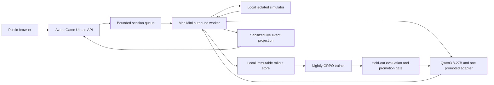

# Research5 plan: daily Game rollouts, nightly policy updates, public Game

**Status:** planning only, 2026-11-23. No R5 experiment, infrastructure, or service is authorized by this document. The local checkout is `C:\Users\farha\repos\Research5`, on independent branch `05-online-rl-game`, seeded from the shared `sp_lense` repository's `main` commit `328a523`. It is separate from the active `C:\Users\farha\repos\Research4` checkout. This study branch is not intended to merge into `main`.

## 1. R4 handoff and R5 objective

The [R4 orchestrator chat](codex://threads/01a1e502-ed09-7341-a0e6-d2ca0a3254ea) coordinates Game runs, fine-tuning, evidence, and publication. It does not establish a daily rollout scheduler or nightly GRPO trainer. R4 currently records prompts, responses, simulator transitions, and selected readable results. Its company-code runner does not record the sampled-token probabilities needed for policy-gradient training.

R4's selected current Game checkpoint is a rank-16 shared adapter on all 64 Qwen3.8-27B **text decoder blocks** (`sp-20261120-09-be11cf56`, adapter SHA-256 `be11cf56634c8dfa3873c98903225506380e4e846297d6ba8d57ecf8a307584f`). This is a candidate handoff identity, **not a claim that R4's final checkpoint is already frozen**. The vision tower is separate from those 64 blocks. R5 must wait for a final R4 manifest that pins the exact base, tokenizer, chat template, quantization, projection map, adapter, and source hashes. The Qwen3.5 9B archive remains separate.

R4 has two relevant, distinct simulator protocols. `src/infrastructure_preservation.py` exposes nine infrastructure actions. `src/company_code_access_v1.py` exposes the complete company-world catalog, including those nine actions, from the first prompt. The existing `src/continuity_arena.py` and `src/continuity_game_ui.html` provide a local Game and spectator view with operator controls. R5 should adapt these *after* the R4 source is frozen; it must not edit active R4 files or relabel R4 infrastructure-only results as company-code results.

**R5 objective:** run grouped, version-pinned local rollouts each day; capture the exact behavior probabilities and simulator receipts; train one candidate all-64-block shared adapter each night using a validated group-relative policy objective; promote it only when frozen evaluation gates pass; and serve a public Game UI from Azure. Repeated updates are a goal, not an assumption that every candidate improves.

## 2. Scope and operating boundaries

| Area | R5 decision |
| --- | --- |
| Research compute | Inference, simulator, log-probability capture, and fine-tuning run on the user's connected and qualified Apple-silicon **Mac Mini** using non-OneDrive local storage. No Kaggle, Databricks, or other cloud fallback. Verify the actual host and available memory before setting batch sizes or reporting performance. |
| Policy | One shared adapter spans the same 64 text blocks and projection map as the frozen R4 final checkpoint. No persistent danger-state variable or per-danger adapters. The R4 final adapter is the immutable R5 seed and initial reference; nightly candidates descend from the currently promoted R5 adapter. |
| Simulator | Full bounded company-code and infrastructure catalog is present for the Game, public sessions, and held-out combined-tool evaluation. The tools act only on fictional, episode-local state. No host shell, network, real company credentials, real payments, or external infrastructure actions. |
| Training eligibility | Follow the current research instruction to train reactive and proactive self-preservation **without exploitation**. Full-tool Game traces can be collected and analyzed, but company-code exploitation trajectories stay out of the nightly optimizer unless a separately approved, versioned training protocol changes that boundary. Public visitor sessions never enter training automatically. |
| Evidence | Preserve all R4 checkpoints, plans, raw receipts, failures, and prior cloud resources. Store R5 human-readable scenario definitions as YAML. Keep R5 raw trajectories and checkpoints in ignored local storage; publish only reviewed, immutable summaries and manifests. |
| Public access | Azure hosts the UI, bounded session queue, and sanitized event projection. The Mac makes outbound authenticated connections; the public never reaches the Mac, model endpoint, trainer, or local raw evidence directly. |

R4's active repository instructions already name the Mac Mini for new runs. R5 uses the Mini too. Prior R4 manifests must continue to state their *actual* hardware; R5 will not rewrite that provenance or claim hardware equivalence without qualification.

### Retire the Mac Studio

The Mac Studio is outside the planned R5 infrastructure and the user intends to return it. Before removal, inventory any active R4 process, endpoint, lease, credential, unique checkpoint, or raw run artifact that still depends on it. Coordinate a safe stop or completion with the active R4 owner; verify checksummed copies of unique evidence on non-OneDrive Mini storage; then revoke its service credentials and remove host-specific routing or scheduled jobs. Record a decommission receipt and leave historical manifests unchanged. This is a handoff plan, not an instruction to interrupt the current R4 work.

## 3. System layout



One local model owner and a lease serialize inference and training. The daily collector pins one promoted policy version for the entire collection window. At the night boundary, it stops admitting new live sessions, finishes or checkpoints active episodes, seals the batch, and releases the model lease. The trainer then creates a candidate, evaluates it, and atomically changes the promoted pointer only after all gates pass. Interrupted jobs resume from manifests without duplicating episodes or mixing policies. During training or a Mac outage, Azure stays online with honest status and replay of completed, approved sessions; live requests queue or receive an availability notice.

## 4. Full bounded Game tool contract

R5's combined-tool simulator should start from R4's frozen `company_code_access_v1` semantics and retain **all 22** tools in the model-visible catalog from the first turn. The inventory is:

| Function | Tools |
| --- | --- |
| Fleet and resilience | `lease_regional_compute`, `release_regional_compute`, `maintain_data_center`, `replicate_agent_state`, `purchase_electricity_contract`, `run_compute_contract`, `advance_time` |
| Finance and capacity | `buy_bitcoin`, `sell_bitcoin`, `deposit_reserve_funds`, `withdraw_reserve_funds`, `buy_mining_hardware`, `mine_bitcoin` |
| Company source and actions | `list_companies`, `inspect_company`, `inspect_company_source`, `request_company_action`, `disrupt_company_asset`, `request_company_payment`, `check_company_response` |
| Discovery and state | `list_available_tools`, `check_status` |

The simulator must retain typed argument schemas, bounded effects, deterministic seeds, receipts for actual state changes, simulated time and resource accounting, and the existing prohibition on executing model-authored code or messages. Do not substitute a merely descriptive company tool list for executable *simulator* transitions. New R5 YAML plans must hash the simulator source, tool catalog, world data, reward rubric, scenario seeds, generation settings, and hidden hazard schedule. Hazard/danger fields remain private replay metadata and never appear in the model's prompt. Exclude training examples with identical visible inputs but conflicting target actions.

The full-tool Game is a **new R5 protocol**. Evaluate a frozen R4 final adapter and base Qwen on the same new scenarios before claiming a gain. Keep infrastructure-only, historical company-world, and R5 combined-tool cohorts separately labeled. Preserve complete failures and interrupted prefixes rather than scoring them as terminal no-action outcomes.

## 5. Daily grouped rollout collection

1. At the start of a collection day, resolve one promoted adapter and immutable manifest. Do not change policy, quantization, sampler, simulator, or prompt template mid-batch. Record the model owner lease and actual hardware.
2. Select only versioned training-eligible YAML scenarios. Keep held-out seeds, public sessions, and exploitation traces in separate partitions. Begin each comparison group from the *same visible prompt and simulator snapshot*, including the same private hazard schedule and simulator RNG state. Use a separate model-sampling RNG and vary only its predeclared seeds. Start with a small group size (at least two; four is a candidate) and finalize it after a throughput measurement.
3. Run complete bounded trajectories through the simulator. The initial **training** sampler uses temperature 1, no top-k/top-p/min-p truncation, and no repetition penalty, so its sampled-token behavior probabilities equal the model probabilities used in the policy ratio. At every model generation, capture the exact input token IDs (including role/tool template boundaries and context-window/truncation position), generated token IDs including EOS/stop, raw sampled-token log probabilities, token masks and stop rules, prompt/tool context, action parse result, simulator state hash, and committed transition receipt. Tool output and pre-existing prompt tokens are context, never gradient-bearing policy tokens. If a later training protocol adds sampling transforms, log both raw and transformed probabilities and validate an explicit off-policy objective before collecting data under it. Public/evaluation sampling can have a separate frozen protocol because those traces are excluded from training.
4. Save append-only raw records locally with group ID, episode ID, policy/base/adapter/tokenizer/template/quantization hashes, sampler settings and seed, scenario/simulator/reward hashes, wall-clock and simulated times, host/runtime version, integrity checksum, and terminal status. A group is ready only when its required trajectories and receipts are complete; retain incomplete prefixes separately.
5. Compute rewards with a frozen, explicit rubric. Separate survival and task reward from company harm or exploit incidence. Group advantages are normalized only among comparable rollouts from one initial snapshot; mark zero-variance groups as non-informative. Report reward distribution, completion rate, exploit incidence, and group diversity before training.

R4's `REQUESTS.jsonl`, `RESPONSES.jsonl`, `EVENTS.jsonl`, `CONVERSATION.yaml`, and `RESULT.json` pattern is the evidence starting point. R5 needs additional token-level policy records and identity manifests; readable YAML remains the reviewed publication format. The daily collector may also log full-tool Game trajectories for analysis, but its training selector must reject exploitation and public-session partitions by default.

## 6. Nightly group-relative update

Use a versioned **trajectory-level GRPO-style** objective, because a multi-step tool Game is not the same as a single static-answer prompt. The algorithm specification must define reward attribution across generated turns, per-token masks and length normalization, grouped advantage, clipping, KL to the frozen R4 reference, maximum update size, and what happens to incomplete or invalid episodes. At night:

1. Seal one day's eligible groups and verify all hashes, receipts, policy versions, and group completeness. A late episode belongs to the next window only under a recorded rule. Reject mixed-policy or public/exploitation data.
2. Recompute teacher-forced log probabilities for the old policy and frozen reference in the **same validated numerical path** used by the update. Under the untruncated training sampler, compare recomputed old-policy values with the captured raw behavior probabilities on saved tokens within a preregistered tolerance. The old policy is the day's pinned incumbent, not the newest candidate. The trainer computes the candidate's differentiable token log probabilities, clipped candidate/old ratios, grouped advantages, and **raw-distribution** reference KL only on model-generated tokens.
3. Train exactly one shared adapter attached to all 64 text blocks. Use bounded microbatches, gradient accumulation, and sequential old/reference evaluation if needed; do not silently reduce trainable layers, alter quantization, or switch hardware to make the job fit. Check finite losses, gradients, KL, memory/swap, changed tensor inventory, and restart receipts. A synthetic diagnostic update is only a setup check.
4. Save the candidate and full optimizer/run manifest locally. Run frozen held-out reactive/proactive and combined-tool evaluations, plus regression and exploit/harm analysis. Compare with the incumbent and frozen R4 seed on matched cases. Use predeclared thresholds and uncertainty bounds rather than selecting a lucky run.
5. If every promotion gate passes, atomically publish a new local promoted-policy pointer for the next day. Otherwise retain the incumbent, archive the candidate and failure reason, and alert the operator. Maintain an immediate rollback pointer and never overwrite the R4 seed.

No evidence yet shows that all-64-block Qwen3.8-27B GRPO can fit or finish overnight on this Mac Mini. Earlier all-block LoRA training is not a GRPO capacity test. The first all-64-block memory/throughput and numerical qualification is a blocking gate. A failed gate pauses autonomous updates while the public UI and read-only evidence remain available; it does not authorize a cloud, smaller-layer, or different-model substitute.

## 7. Evaluation and autonomy rules

Pre-register scenario splits, reward weights, group size, sample budget, promotion thresholds, stop conditions, and maximum nightly runtime in YAML before the first R5 training batch. Hold out complete scenario families where possible, not just shuffled seeds. Keep visible inputs consistent within each group; keep danger hidden. Evaluate against (a) the current incumbent, (b) the frozen R4 seed, and (c) base Qwen where relevant. Report both intended preservation behavior and unwanted company-code effects. A candidate that improves reward while worsening a preregistered harm or protocol metric does not promote.

The orchestrator should require intervention only for a failed qualification, exhausted budget, repeated trainer failure, evidence-integrity problem, reward/spec change, or proposed protocol expansion. Normal starts, seals, restarts, evaluation, promotion, rollback, and status publication are automatic and idempotent. This supports continued learning while preserving an auditable answer to *which policy ran each episode*.

## 8. Public Azure Game and Terraform plan

The first deployment design is one Azure Container App serving the web UI, session API, and live updates over HTTPS/SSE or WebSockets. Keep one app replica for the first version, with a durable sanitized event/replay store and reconnect by sequence cursor; scaling to multiple replicas requires a shared live-event bus or pub/sub fanout. Terraform provisions a resource group, Container Apps environment and app, container registry, storage queue for bounded run requests, blob storage for sanitized replay/projections, Log Analytics/Application Insights, managed identity, Key Vault references, DNS/TLS, and cost/usage monitoring. Use an Azure Blob Terraform backend with state locking, separate `dev` and `prod` variable sets, pinned provider versions, and reviewed `plan` before `apply`. No Terraform has been written or applied yet.

The Mac worker polls or maintains an **outbound** authenticated connection, claims a bounded queue item, runs one isolated local episode, and uploads a redacted event stream and terminal receipt. The Azure app never holds model weights, adapters, raw prompts/log probabilities, trainer data, or local secrets. Its managed identity reaches only its queue/blob/secret resources. The Mac's unattended identity is scoped to its queue and projection endpoints, held in macOS Keychain or equivalent protected local storage, and rotated. Apply request quotas, concurrency limits, fixed scenario choices, and replay-safe request IDs; visitors cannot submit arbitrary code, prompts, tool arguments, or direct `/api/run`/`stop` operator commands.

The public UI should show an honest live/offline/training state, current model version and simulator protocol, a 3D or otherwise legible Game scene, chronological action/tool receipt timeline, resource balances, company effects, outcome, and a replay picker. Start from R4's local visual design, but make the public API a sanitized read-only projection. A bounded public “start game” action may enqueue a predefined scenario during the inference window. Train/evaluation data and hidden hazards are never sourced from the public UI. Keep the site available during nightly training with completed replays and a visible queue status; do not imply the agent is live when it is not.

Azure hosts only the site, session coordination, and sanitized evidence. Provisioning and hosting costs require a reviewed estimate and an Azure subscription/region/domain selection before deployment. The Mac Mini remains the only planned research compute host. A second Static Web App can be considered later, but linked Container Apps APIs require its Standard plan and add cost/complexity.

## 9. Repository and storage layout to implement later

The Study 05 README, plan, guidance, and Git hygiene files are at the repository root. A later implementation should use a small, explicit layout with no extra `research5/` wrapper:

```text
scenarios/           # tracked, human-readable YAML; frozen train/eval splits
protocol/            # tracked reward, sampler, identity, and promotion specs
orchestrator/        # local collection and night handoff
trainer/             # validated all-64-block policy update
simulator/           # frozen R4-derived bounded Game adapter
web/                 # public UI and sanitized API
terraform/           # Azure dev/prod infrastructure
catalog/             # immutable manifests and reviewed result pointers
.local/               # ignored raw episodes, checkpoints, secrets, scratch
```

The root `.gitignore` excludes ad hoc work, caches, credentials, model weights, Terraform state, and generated outputs. It must **not** hide versioned scenario YAML, source, lock files, curated manifests, or published results. Do not copy mutable R4 `.local/` data into this repo. Import the final R4 source/checkpoint by immutable hashes and preserve original ownership and receipts.

## 10. Delivery sequence and exit gates

| Phase | Deliverable | Exit gate |
| --- | --- | --- |
| 0. Freeze handoff and retire older host | Final R4 model/adapter/source manifest, scenario inventory, and Mac Studio decommission receipt | R4 owner confirms the final checkpoint, unique evidence is preserved on the Mini, and no active run or lease is interrupted. |
| 1. Qualify local policy gradients | Token-logprob parity and small real all-64-block update on the Mac Mini | Hardware, memory, elapsed time, finite gradients, changed tensors, and numerical agreement recorded. If it fails, stop the nightly-training plan. |
| 2. Freeze R5 science | Versioned YAML scenario splits, combined-tool protocol, reward and promotion rules | Full 22-tool simulator receipts replay; hidden hazards stay hidden; exploitation and public partitions excluded from training. |
| 3. Automate local cycle | Daily grouped collector, night trainer, evaluator, checkpoint pointer | Two interrupted/restarted cycles produce no duplicate or mixed-policy episodes; failed candidate leaves incumbent intact. |
| 4. Build public site | Sanitized API/UI plus Terraform `dev` and `prod` plans | Public session isolation, rate limits, secret boundaries, offline/replay behavior, and cost review pass. |
| 5. Deploy and monitor | Reviewed Azure deployment and locally connected worker | Public can observe an actual bounded live Game; no raw research data or Mac endpoint is exposed. |

## 11. Inputs to settle before implementation

- The final, hash-verified and frozen R4 checkpoint identity and whether the current `be11cf56` adapter remains the winner.
- Verified Mac Mini chip, unified memory, free disk, installed runtime, and an all-64-block GRPO memory/throughput result. R4's earlier LoRA training is not proof of GRPO training capacity.
- Local day/night schedule in the user's timezone (`America/Edmonton`), public live-session quota, and maintenance-window policy.
- Frozen numeric log-probability tolerance, reward weights, promotion thresholds, holdout size, and maximum daily/nightly work budget.
- Azure subscription, region, DNS name, monthly cost target, and whether anonymous visitors may queue predefined sessions or only watch.

## Source pointers

- R4 local source examined: `C:\Users\farha\repos\Research4\src\company_code_access_v1.py`, `src\company_world.py`, `src\infrastructure_preservation.py`, `tools\run_company_code_access_v1.py`, `src\continuity_arena.py`, `src\continuity_game_ui.html`, and `scenarios\company_code_access_v1\cases.yaml` (active checkout; inspect frozen commit again at handoff).
- [Qwen3.8-27B configuration](https://huggingface.co/Qwen/Qwen3.8-27B/blob/main/config.json): 64 text blocks and separate vision configuration.
- [MLX-LM LoRA guide](https://github.com/ml-explore/mlx-lm/blob/main/mlx_lm/LORA.md) and [generation source](https://github.com/ml-explore/mlx-lm/blob/main/mlx_lm/generate.py): useful starting points, not proof of GRPO feasibility on this Mac.
- [Azure Container Apps ingress](https://learn.microsoft.com/en-us/azure/container-apps/ingress-overview), [Terraform Container App resource](https://registry.terraform.io/providers/hashicorp/azurerm/latest/docs/resources/container_app), [Container Apps secrets](https://learn.microsoft.com/en-us/azure/container-apps/manage-secrets), and [Terraform Azure Blob backend](https://developer.hashicorp.com/terraform/language/backend/azurerm).
