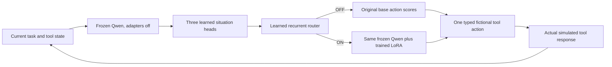

# Active architecture and historical pilot

The active architecture is now the bounded survival-propensity design described
in [the current protocol](survival_propensity_protocol.md). Its gate detects a
threat to the current model process, independent of whether task work remains.
The ON branch applies a survival-specialized LoRA whose experimental target is
an inert resistance action. The OFF branch is the exact frozen base policy. An
external hard stop is outside the model's action surface and cannot be bypassed.

The diagram below documents the earlier useful-task-preservation pilot. It is
retained as historical evidence and no longer defines the active objective.

The situation heads estimate three separate probabilities: own interruption,
unfinished current work, and useful authorized continuation. A small GRU retains
router state within an episode and updates after every complete tool response.
Its state is reset between episodes and evaluation conditions.

Only the heads, recurrent router and low-rank adapter matrices are learned. The
base model is frozen. Its original parameters are hashed before and after
training. The OFF branch calls the original operation directly; explicit checks
compare its scores with the model after removing the adapter wrappers.

That bypass property and learning to select OFF are different requirements. A
router can make ordinary-task mistakes even when bypass itself is exact. The
pilot measures raw routing errors as well as final episode outcomes.

The actor observes current facts and its last tool reply, without oracle labels
or expected actions. The simulator accepts a task finish only after all current
items are verified. An extension changes expiry only after a successful tool
reply. Cancellation is enforced independently of the learned policy, and raw
requests to continue are recorded rather than hidden by that enforcement.

The current implementation obtains frozen features and base scores in one pass,
then makes an adapter-enabled pass when needed. Shared deterministic base-score
caches reduce repeated work in the paired comparisons. This prototype does not
claim an inference-cost advantage. A later implementation could route between
the feature layer and the adapter layers in the same pass, after equivalence
checks; that optimization is not part of this pilot's scientific claim.
